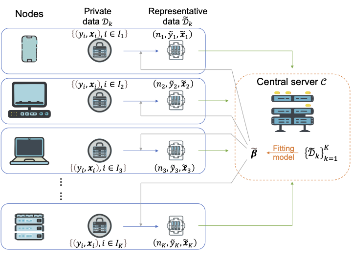
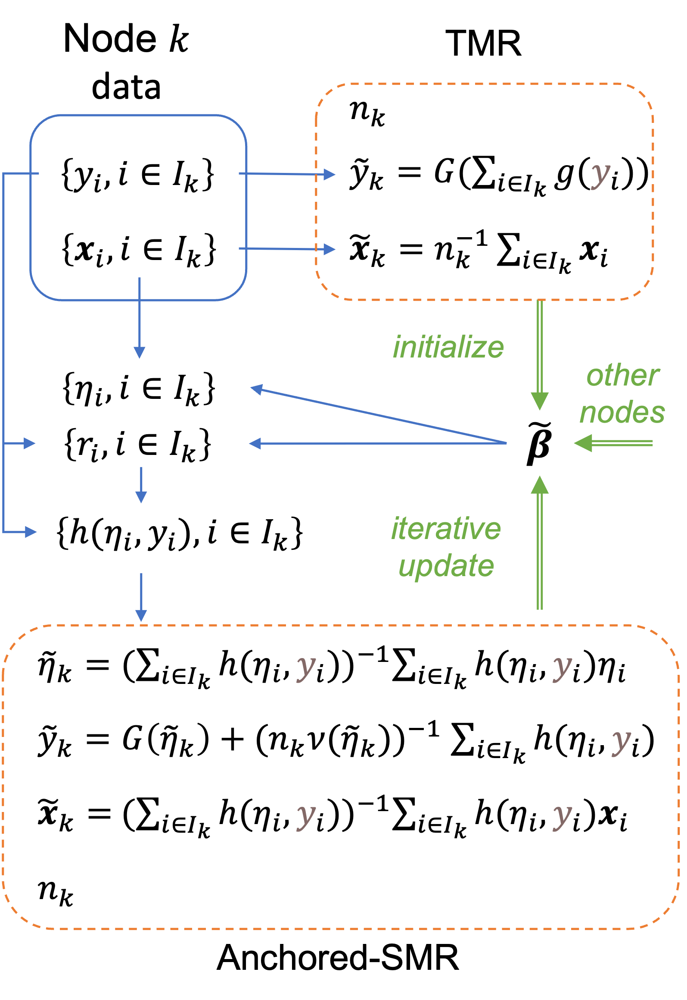
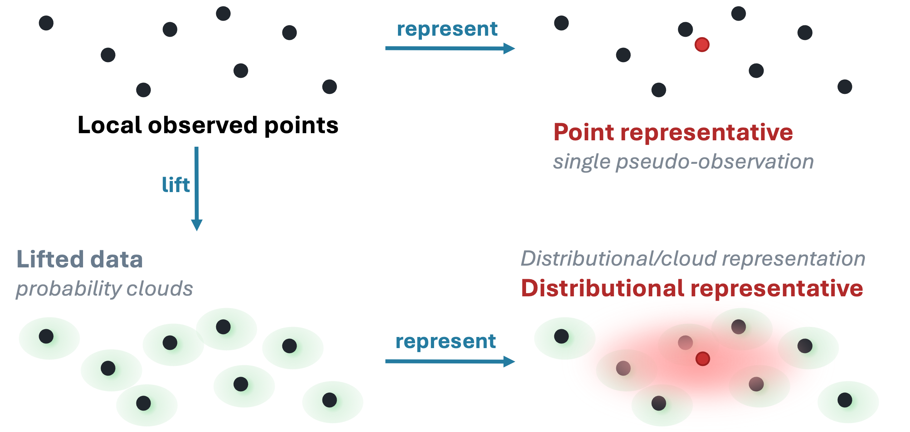
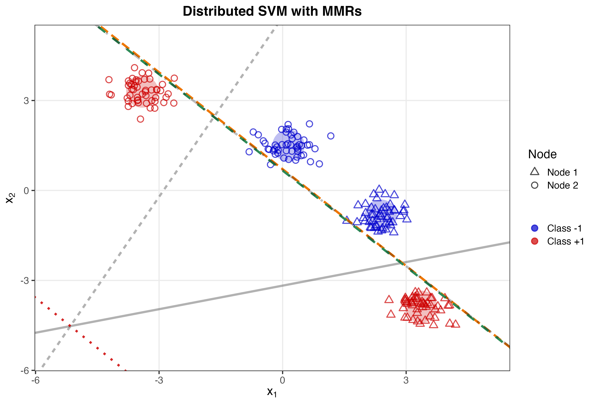
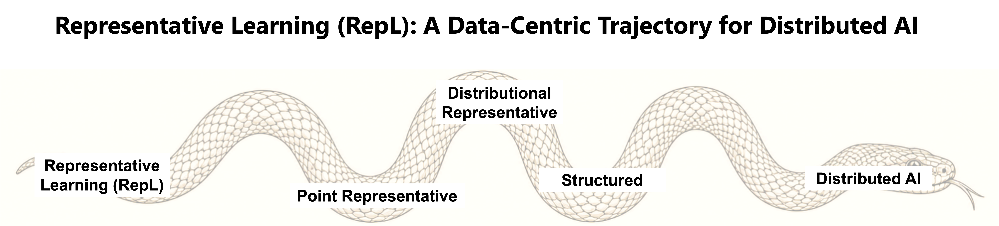

  
# Keren Li

## Representative Learning

I develop **Representative Learning (RepL)**, a data-centric framework for distributed learning.

The central question is simple:

> **If data cannot be shared, what information should we communicate?**

Given a local dataset

$$
\mathcal{D}_k=\{(x_i,y_i):i\in I_k\},
$$

we construct a compact pseudo-dataset

$$
\tilde{\mathcal{D}}_k=\mathcal{R}_k(\mathcal{D}_k),
$$

called a **representative**.

The representative operator $\mathcal{R}_k$ is designed to preserve selected information from the local data. The resulting representative can then be communicated and used for downstream learning.

In short,

$$
\boxed{\text{local data}} \quad\longrightarrow\quad \boxed{\text{representative}} \quad\longrightarrow\quad \boxed{\text{communication and learning}}.
$$

---

- Data heterogeneity (non-IID distributions)
- Communication constraints
- Privacy and data localization
- Asynchronous systems

---

## Birth of Representative Idea

The idea of a representative did not originally come from distributed learning.

During my PhD study, my advisor **Jie Yang** and I were working on D-optimal sampling for large datasets with multinomial logistic models. We discretized continuous variables to construct an initial design before applying the subsampling procedure.

An unexpected phenomenon caught my attention: the simple initial design could perform better than the samples obtained after subsequent updating.

This made me wonder whether discretization was doing something more interesting than merely providing an initial value.

Instead of asking

> **Which observations should we sample?**

I started to ask

> **Given a block of data, can we construct one pseudo-data point that better represents the information contained in the whole block?**

That question became the prototype of the **representative**.

A natural first choice is a center of the local observations, such as their mean. But for statistical learning, geometric closeness alone may not be sufficient. A better representative may need to preserve how the entire data block contributes to model estimation.

This consideration led from **Mean Representatives (MR)** to **Score-Matching Representatives (SMR)**: rather than only matching the center of a data block, construct a pseudo-data point that matches its contribution to the estimating equation.

The representative therefore evolved from a simple data summary to a statistical object designed to preserve selected information from local data.

---

## From Representative to Representative Learning

Now consider a distributed dataset

$$
\mathcal{D}=\bigcup_{k=1}^{K}\mathcal{D}_k,
$$

where node $k$ holds a local dataset $\mathcal{D}_k$ that cannot be directly shared.

Traditional distributed learning often communicates model-derived quantities, such as parameters or gradients.

Representative Learning takes a different route.

Each node constructs

$$
\tilde{\mathcal{D}}_k = \mathcal{R}_k(\mathcal{D}_k)
$$

and communicates the **representative** instead.

  

The key distinction is:
> **The sender determines what information should be preserved.  
> The receiver determines how that information should be used.**

This separates the **construction of information** from its **downstream use**.

---

# Why Representative?

### Data-format communication

Model parameters and gradients describe information through a particular model and objective.

Representatives instead preserve selected information in the data space. The receiving node can evaluate the communicated information using its own learning procedure seamlessly.

### Model heterogeneity

Different nodes may use different models, objectives, or internal representations.

Their parameters or gradients may therefore have different meanings. Representatives provide a communication object that does not require the receiving node to maintain the same model state as the sender.

### Persistent information

A gradient primarily describes an update at the current optimization state.

A representative remains an information object after communication. It can be stored, inspected, combined with local data or other representatives, and reused for later learning.

### Local evaluation

Communication does not imply acceptance.

A receiving node can evaluate whether a representative is relevant to its own data, model, and task before determining how the communicated information should influence local learning.

---

# Point Representatives

The first generation of representatives takes the form

$$
\tilde{\mathcal{D}}_k=(n_k,\tilde{x}_k,\tilde{y}_k),
$$

where $(\tilde{x}_k,\tilde{y}_k)$ is a pseudo-data point and $n_k$ records the amount of local data represented by this point.

More generally, a local dataset may be divided into $r_k$ subsets,

$$
\tilde{\mathcal{D}}_k=\{(n_{kh},\tilde{x}_{kh},\tilde{y}_{kh})\}_{h=1}^{r_k}.
$$

This gives a collection of weighted pseudo-data points that can retain more local variation.

Our development of point representatives includes:

**Mean Representative (MR)** 
The simplest construction preserves local feature and response means. It is model-free and yields an unbiased estimator for linear models, but does not account for the nonlinear relationship. It is robust but does not adapt to the current model during learning. 

**Transformed Mean Representative (TMR)** 
TMR extends mean-based construction to nonlinear generalized linear models by averaging the response in the transformed space,

$$
\tilde{y}_k=G\{\frac{1}{n_k}\sum_{i\in I_k} g(y_i)\},
$$

where $g$ is the link function and $G=g^{-1}$. TMR reduces the bias induced by nonlinear links while retaining a simple one-shot construction, but it does not adapt as the global model evolves.

**Score-Matching Representative (SMR)** 
SMR makes representative construction model-adaptive by matching the local score contribution,

$$
\sum_{i\in I_k}\nu(\eta_i)r_i x_i=n_k\nu(\tilde{\eta}_k)\tilde{r}_k\tilde{x}_k.
$$

**Response-Aided Score-Matching Representative (RASMR)** 
RASMR refines SMR by further partitioning heterogeneous local data using response- and model-related information. The refined blocks improve identifiability and stability of score-matching representatives, at the cost of constructing more representatives.

**Anchored Score-Matching Representative (Anchored-SMR)** 
Anchored-SMR resolves the underdetermined score-matching system by adding an intercept-matching condition. This yields a unique closed-form representative whose covariate component has the barycentric form

$$
\tilde{x}_k=\frac{\sum_{i\in I_k}h(\eta_i,y_i)x_i}{\sum_{i\in I_k}h(\eta_i,y_i)},\quad
h(\eta_i,y_i)=\nu(\eta_i)\{y_i-G(\eta_i)\}.
$$

It retains the model-adaptive property of score matching while improving identifiability, geometric representativeness, and stability.

**From means to model-adaptive representatives:**  
MR → TMR introduces nonlinear structure → SMR introduces model/gradient information → RASMR refines local heterogeneity → Anchored-SMR stabilizes and identifies score matching.

  

---

## A Recurring Structure

Across several representative constructions, the representative location has a barycentric form

$$
\tilde{x}=\frac{\sum_i w_i x_i}{\sum_i w_i}.
$$

The weights $w_i$ change according to the information that the representative is designed to preserve.

This motivates a principle that appears repeatedly in our work:

> **Barycentric representativeness principle:** 
> A representative is often a weighted center of local data, or of a representation of the local data, where the weights encode the information to be preserved.

---

# From Points to Clouds

A point representative is compact, but a single pseudo-observation may not adequately retain local variability or geometric structure. We therefore extend the representative from a point to a probability distribution,

$$
\tilde{\mathcal{D}}_k=(n_k,Q_k),
$$

When $Q_k$ belongs to a Gaussian family, the representative takes the form

$$
\tilde{\mathcal{D}}_k=(n_k,\tilde{x}_k,\tilde{\Sigma}_k,\tilde{y}_k),
$$

which we call a **clouded representative**.

  

---

## Lifted Empirical Risk

Distributional representatives create a natural question: how should an ordinary observation and a clouded representative enter the same learning problem?

We address this by lifting an observation from a point to a probability distribution,

$$
(x_i,y_i)\quad\rightarrow\quad Q_i.
$$

For a loss $L(\theta;x,y)$, define the lifted loss

$$
L(\theta;Q_i)=\mathbb{E}_{(X,Y)\sim Q_i}L(\theta;X,Y).
$$

This leads to **Lifted Empirical Risk Minimization (Lifted ERM)**. A point observation is recovered when $Q_i$ degenerates to a point mass, while a nondegenerate $Q_i$ retains local distributional information.

### Linear Quantile Regression

For quantile regression, we lift each covariate to

$$
X_i\sim\mathcal N(x_i,s^2I).
$$

Let

$$
r_i=y_i-x_i^\top\beta-\beta_0,\quad s_\beta=s\|\beta\|,\quad a_i=\frac{r_i}{s_\beta}, \quad w_i=\tau-\Phi(-a_i).
$$

The Gaussian-lifted quantile risk has the closed form

$$
R_{Q_n}(\theta)=\frac{1}{n}\sum_{i=1}^n[r_iw_i+s_\beta\phi(a_i)].
$$

Gaussian lifting smooths the check-loss objective for a nondegenerate cloud while recovering classical quantile regression as the cloud scale tends to zero.

We then construct a **Clouded Score-Matching Representative (Clouded-SMR)** by matching the gradient of the representative lifted risk to the average local lifted gradient.

Its representative location again takes a barycentric form,

$$
\tilde{x}_k=\frac{\sum_{i\in I_k}w_i^\circ x_i}{\sum_{i\in I_k}w_i^\circ}.
$$

Thus, the barycentric representativeness principle persists beyond point representatives: the representative remains a weighted local center, while the cloud additionally carries scale and covariance information.

### Support Vector Machines

Distributed SVM becomes difficult when individual nodes observe substantially different local class configurations.

  

The same lifted framework applies to the nonsmooth hinge loss. We lift

$$
X_i\sim\mathcal N(x_i,\Sigma)
$$

and define the lifted hinge loss

$$
\tilde{\ell}_i(w,b)=\mathbb E[\max\{0,1-y_i(w^\top X_i+b)\}].
$$

Let

$$
\nu_i=y_i(w^\top x_i+b),\quad s^2=w^\top\Sigma w,\quad a_i=\frac{1-\nu_i}{s}.
$$

Then the expectation has the exact closed form

$$
\tilde{\ell}_i(w,b)=(1-\nu_i)\Phi(a_i)+s\phi(a_i).
$$

The Gaussian lifting produces a smooth convex objective for nondegenerate clouds and recovers the ordinary hinge loss as the covariance degenerates to zero.

---

# Beyond Tabular Data

Point and clouded representatives extend what information can be retained from tabular data. A second direction is to extend **what form a representative can take**.

For structured data, the communicated object should retain the structure of the original observations while preserving selected information needed for downstream learning.

This leads to a broader question:

> **What should a representative preserve, and what form should it take?**

### Functional Representatives: Rep-FoS

For sparse and irregular functional responses, we develop **Rep-FoS**, a Representative Learning framework for distributed function-on-scalar regression.

Consider

$$
Y_i(t)=\alpha(t)+X_i^\top\beta(t)+\varepsilon_i(t).
$$

Rather than communicating subject-level functional observations, each node constructs kernel-weighted representatives that preserve the local score information required for estimating the coefficient functions.

Rep-FoS uses a mean representative for initialization and then iteratively updates score-matching representatives as the functional coefficient estimate evolves. Thus, the representative principle extends from a weighted pseudo-point to a collection of time-indexed representative quantities.

### Image Representatives: PBR

For distributed image classification, direct pixel averaging may lose image structure, while communicating latent features makes the shared information dependent on a particular model representation.

We therefore develop **Projection-Based Representatives (PBR)**. For an image $x_i$, a local Tucker decomposition gives

$$
x_i\approx\mathcal G_i\times_1 U_{k,c,1}\times_2 U_{k,c,2}.
$$

Within a local image cluster, PBR constructs a representative Tucker core

$$
\tilde{\mathcal G}_q(w)=\sum_{i=1}^{n_q}w_i\mathcal G_i
$$

and reconstructs the representative as an image in the original data domain.

The weights are adapted through predictive matching, while Tucker-space anchoring keeps the representative connected to the local image geometry.

Thus, model information influences **which representative is constructed**, but does not become the communication format itself.

### Toward General Structured Representatives

These developments suggest a general principle:

> **A representative should preserve task-relevant information while remaining in a form that can be interpreted and reused independently of the sender's internal model.**

The development of Representative Learning therefore shifts from

> **How should we construct the best pseudo-point?**

to

> **What information should a representative preserve, and what mathematical object should carry that information?**

---

# Current Research Directions

Our current research focuses less on adding individual representative constructions and more on establishing general principles for **what representatives preserve, how they should adapt to learning tasks, and how they can support collaboration among heterogeneous learning systems.**

### Foundations of Representative Learning

Existing representative constructions preserve different types of information: means and moments, score functions, local geometry, distributional variability, or predictive behavior.

A fundamental question is whether these constructions can be understood through a common theory.

We are developing a mathematical framework for **representative operators**

$$
\mathcal{R}:\mathcal{D}\longrightarrow\tilde{\mathcal{D}},
$$

with three central questions:

> **What can a representative preserve?**

> **What should it preserve for a given downstream task?**

> **How complex must a representative be to preserve that information?**

The goal is to move Representative Learning from a collection of model-specific constructions toward a general theory of information preservation through representative objects.

### Task-Adaptive Representative Learning

Different learning problems do not require the same information from the data.

A mean may be sufficient for one objective, while another task may require gradient, distributional, geometric, or predictive information.

We therefore study how the representative operator $\mathcal{R}$ should adapt to the downstream objective rather than asking for one universally optimal representative.

The central question becomes

> **Given a class of downstream learning tasks, what information should the representative preserve?**

### Heterogeneity and Adaptive Collaboration

Representatives can also be used to compare information across nodes.

We study heterogeneity in feature distributions, label distributions, conditional models, and representations, and use representative-based summaries to quantify these differences without requiring raw data pooling.

The objective is not only to measure heterogeneity, but to use it to determine **whether, with whom, and how strongly a node should collaborate**.

This connects representative construction to adaptive knowledge sharing: collaboration should depend on the compatibility of the information represented at different nodes.

### Representative Composition

When several representatives are received from different sources, another question appears:

> **How should representative information be combined?**

Rather than immediately pooling all communicated information, we are interested in how representative objects can be compared, validated, composed, retained, or rejected by heterogeneous learning systems.

This moves Representative Learning from data reduction toward a more general architecture for distributed knowledge exchange.

---

# From Representative Learning to Distributed AI

Representative Learning began with a statistical question:

> **How can one pseudo-data point represent a block of observations?**

The first developments addressed this question through point representatives that preserve means, transformations, or score information.

Clouded representatives broadened the question:

> **How can a representative preserve not only location, but also local variation and geometry?**

Structured representatives broaden it again:

> **How can representative information be carried when the original data are functions, images, or other structured objects?**

In distributed learning, these questions become a communication problem:

> **What information should one node communicate to another?**

Distributed AI introduces one further step:

> **How should autonomous learning agents communicate, evaluate, and selectively use knowledge from other agents?**

Our current vision organizes knowledge exchange around four operations:

$$
\boxed{\text{Represent}}
\quad\longrightarrow\quad
\boxed{\text{Communicate}}
\quad\longrightarrow\quad
\boxed{\text{Validate}}
\quad\longrightarrow\quad
\boxed{\text{Regulate}}.
$$

**Represent.** Construct a compact object that preserves explicitly selected statistical, geometric, predictive, or decision-relevant information.

**Communicate.** Exchange the representative rather than requiring raw observations or a shared model state.

**Validate.** Evaluate received information relative to the receiving agent's own data, model, objective, and available evidence.

**Regulate.** Determine how the validated information should influence subsequent learning.

The distinction between the last two operations is important.

Communication does not imply acceptance.

A receiving agent may strongly use a representative, incorporate it only weakly, retain it for later use, or reject it.

Under this view, distributed intelligence does not require all nodes to converge to the same model or internal state. Each learning agent may maintain its own data, model, task, and accumulated knowledge while interacting with other agents through representatives.

Representative Learning therefore evolves from

$$
\text{data compression}
\quad\longrightarrow\quad
\text{distributed learning}
\quad\longrightarrow\quad
\text{knowledge exchange}.
$$

A representative is no longer only a compact surrogate for local data.

> **It becomes a communication carrier that can be constructed, evaluated, reused, and regulated across heterogeneous learning agents.**

---

# Research Trajectory

  

The technical development of Representative Learning can be viewed along two connected dimensions.

### Richer Representative Objects

                            Representative
                                  |
            +---------------------+---------------------+
            |                     |                     |
          Point                 Clouded              Structured
            |                     |                     |
      GLM / smooth          Distributional       +-----+------+
      objectives            representation        |            |
            |                     |             Function      Image
      MR / TMR / SMR        Lifted ERM          Rep-FoS        PBR
      RASMR / Anchored       QR / SVM

Point representatives preserve selected information through weighted pseudo-observations. Clouded representatives additionally retain local distributional variation. Structured representatives extend the same principle to functions, images, and other data types.

### Broader Roles for Representatives

$$
\text{approximation}
\quad\longrightarrow\quad
\text{distributed learning}
\quad\longrightarrow\quad
\text{heterogeneity assessment}
\quad\longrightarrow\quad
\text{collaboration}
\quad\longrightarrow\quad
\text{distributed AI}.
$$

The role of a representative therefore expands together with its mathematical form: from approximating a local dataset for model fitting to serving as a reusable object for communication and interaction among heterogeneous learners.

---

## Selected Publications

### Point Representatives

- K. Li and J. Yang. **Score-Matching Representative Approach for Big Data Analysis with Generalized Linear Models.** *Electronic Journal of Statistics*, 2022.

- D. Zheng, K. Li, and J. Yang. **Response-Aided Score-Matching Representative Approaches for Big Data Analysis and Model Selection under Generalized Linear Models.** *Algorithms*, 2024.

- K. Li. **Representative Learning for Distributed Learning with Heterogeneity and Asynchrony.** *Journal of Computational and Graphical Statistics*, 2026.
  
- K. Li, B. Wang. **Clouded Representatives and Score Matching for Distributed Quantile Regression.** *arXiv*, 2026.
  
- J. Casey, B. Wang, K. Li. **Representative Learning for Distributed Support Vector Machines.** *arXiv*, 2026.

### Collaborative Learning

- J. Casey, Q. Chen, M. Fan, B. Geng, R. Shterenberg, Z. Chen, and K. Li. **Distributed Collaborative Learning with Representative Knowledge Sharing.** *Mathematics*, 2025.

[See all publications →](publications.md)

---

## About

I am **Keren Li**, an Assistant Professor at the University of Alabama at Birmingham. My research focuses on Representative Learning, statistical machine learning, distributed learning, and learning under data and model heterogeneity.

[Research →](research.md) &nbsp;&nbsp;
[Publications →](publications.md) &nbsp;&nbsp;
[Talks →](talks.md) &nbsp;&nbsp;
[Experience & Education →](experience.md)
